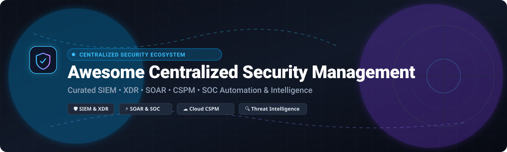

# Awesome-Centralized-Security-Management

# Awesome-Center-Of-Excellence-Management 🏛️ 🎯

  

  
  
  
  
  
  

---

## 🌟 Top Center of Excellence Management Ecosystem

**Curated List of Commercial PPM Platforms & Open-Source Governance Frameworks**  
*Focused on Portfolio Management, Strategic Alignment, Resource Capacity Planning, OKR Cascading & Self-Hosted PMO Governance*

**Last updated: October 2026** 📅

---

### 📌 Overview & SEO Summary
Welcome to the ultimate curated directory of **Center of Excellence management platforms**, **open-source PPM frameworks**, and **governance orchestration tools**. Whether you are looking for enterprise-grade commercial solutions (such as *Planview*, *ServiceNow SPM*, and *Celonis*), or self-hostable open-source alternatives (like *OpenProject*, *Leantime*, and *LibrePlan*), this list covers category leaders, portfolio alignment, and privacy-respecting CoE governance.

**Key Market Context:**
- **PegaWorld 2025 highlighted how leading COEs** drive continuous innovation by enabling business architects and lead system architects to translate business needs into functional designs, then hand off to configuration teams for scalable builds [citation:1].
- **Red Hat's CoE for Ansible** formalizes automation standards, defines key roles (product owners, architects, engineers, platform engineers, security stakeholders), and establishes governance through Git-based repositories, Ansible Lint, and shared CI/CD pipelines [citation:2].
- **OpenProject is the leading open-source PPM platform** — trusted by enterprises, public institutions, and regulated industries for project and portfolio management, Gantt charts, agile boards, and data sovereignty [citation:12].
- **Leantime takes a strategy-first approach** — embedding OKRs directly into the project lifecycle, linking milestones to strategic pillars, and scoring projects on an effort-vs-impact matrix [citation:3].
- **LibrePlan 1.6.0** (released May 2026) adds **issue and risk log management, project document repositories, project pipeline overview, and expanded email notifications** — specifically designed for public-sector governance and digital sovereignty [citation:4].
- **Odoo Community's Project module** integrates PPM with ERP financial data — cost tracking, billing, and profitability dashboards — eliminating the disconnect between portfolio decisions and financial reality [citation:3].
- **The Essential Open Source EA Tool** provides ~80 out-of-the-box reports for Application Portfolio Management, while **Archi** (the official ArchiMate implementation) excels at individual application modeling with Git-based collaboration [citation:13].
- **MyGGI (OSPO Alliance)** provides a push-button GitLab infrastructure for establishing an Open Source Program Office — a specialized CoE — in 10 minutes using Gitea/GitLab issues as activity tracking [citation:10].
- **Innersource patterns** offer an alternative to bottleneck-prone CoEs: default to internal repository visibility, use CODEOWNERS for required reviewers, and accept contributions from anywhere in the company through pull requests [citation:18].

---

## 📑 Table of Contents
- [🏢 SaaS & Commercial Platforms](#-saas--commercial-platforms)
- [🔓 Open-Source GitHub Projects](#-open-source-github-projects)
- [🛠️ How to Contribute](#%EF%B8%8F-how-to-contribute)
- [📊 Star History](#-star-history)
- [🤝 Support & Sponsorship](#-support--sponsorship)
- [⚠️ Disclaimer](#%EF%B8%8F-disclaimer)

---

## 🏢 SaaS / Commercial Platforms

The Center of Excellence management market spans **enterprise PPM suites** (Planview, ServiceNow SPM, Clarity PPM) that provide **portfolio governance, resource capacity planning, and strategic alignment**, **work management platforms** (Smartsheet, monday.com, Asana) that focus on **collaborative execution and lightweight portfolio views**, and **process intelligence platforms** (Celonis) that **mine event logs to identify process inefficiencies and automation opportunities**. **Planview** uses **custom enterprise pricing** with **multi-year contracts**. **ServiceNow SPM** is **included with ServiceNow platform licensing**. **Celonis** starts at **~$50,000/year** for process mining deployments .

| SaaS / Commercial Platform | Company / Owner | Valuation / Market Cap | Standard Edition Starting Price | Free Tier / Free Trial Limits | Description |
| :--- | :--- | :--- | :--- | :--- | :--- |
| **[Salesforce Center of Excellence](https://www.salesforce.com/)** ☁️ | Salesforce | ~$250 Billion | **Custom enterprise pricing** | **Free: Salesforce Trailhead CoE resources** | **CRM-native CoE governance** — **Salesforce CoE framework for governing Salesforce implementations** . **Trailhead modules for CoE establishment** . **Best for Salesforce-centric organizations** . |
| **[Planview](https://www.planview.com/)** 🎯 | Planview | ~$2 Billion | **Custom enterprise pricing** | **Demo available** | **Enterprise PPM and strategic portfolio management** — **Portfolio prioritization, resource capacity planning, and financial governance** . **The most comprehensive enterprise PPM platform** . |
| **[ServiceNow SPM](https://www.servicenow.com/)** 🟢 | ServiceNow | ~$150 Billion | **Included with ServiceNow platform** | **Free: ServiceNow Personal Developer Instance** | **Strategic Portfolio Management** — **Demand management, portfolio planning, and project execution** . **Deep integration with ServiceNow ITSM and ITBM** . |
| **[Celonis](https://www.celonis.com/)** ⚙️ | Celonis | ~$13 Billion | **~$50,000/year** (starting)  | **Free: Celonis Academic Alliance**  | **Process mining and execution management** — **Mines event logs to identify process inefficiencies** . **Process Intelligence Graph for automation opportunities** . |
| **[Adobe Workfront](https://www.workfront.com/)** 🎨 | Adobe | ~$200 Billion | **Custom enterprise pricing**  | **Demo available** | **Enterprise work management** — **Project, portfolio, and resource management** . **Adobe Experience Cloud integration** . |
| **[Asana Enterprise](https://asana.com/)** 📊 | Asana | ~$3 Billion | **Custom enterprise pricing**  | **Free tier: limited** | **Work management platform** — **Portfolio views, goals, and resource management** . **Enterprise-grade security and governance** . |
| **[monday.com Enterprise](https://monday.com/)** 📈 | monday.com | ~$10 Billion | **Custom enterprise pricing**  | **Free tier: limited** | **Work OS platform** — **Portfolio dashboards, resource management, and automation** . **Enterprise-grade governance** . |
| **[Clarity PPM](https://www.broadcom.com/)** 🏢 | Broadcom | ~$60 Billion | **Custom enterprise pricing**  | **Demo available** | **Enterprise PPM by Broadcom** — **Portfolio investment planning, resource management, and financial governance** . |
| **[LeanIX](https://www.leanix.net/)** 🔷 | SAP | ~$200 Billion | **Custom enterprise pricing**  | **Demo available** | **Enterprise architecture management** — **Application portfolio management, technology risk, and roadmap planning** . **SAP integration** . |

---

## 🔓 Open-Source GitHub Projects

*Sorted by GitHub_Stars_Count (Descending)* 🌟

- **[OpenProject](https://github.com/opf/openproject)**   
  **The leading open-source project management software**, GPL-3.0 licensed. **Trusted by enterprises, public institutions, and highly regulated industries** . **Project and portfolio management, agile boards (Kanban, Scrum, SAFe), Gantt charts, product and release planning, time tracking, cost reporting, budgeting, bug tracking, wikis, forums, and meeting management** . **Integrations with Nextcloud, XWiki, GitHub, and GitLab** . **Community Edition free forever; Enterprise from €5.95/user/month** . **The most complete open-source PPM alternative to Jira and MS Project** . 🏛️

- **[Redmine](https://github.com/redmine/redmine)**   
  **Flexible project management web application**, GPL-2.0 licensed. **Unlimited customizability via plugins and Ruby on Rails** . **Ticket and Gantt views across projects** . **100% free and open source** . **The original open-source project management tool** . 📋

- **[Taiga](https://github.com/kaleidos-ventures/taiga)**   
  **Agile project management for multi-team portfolios**, AGPL-3.0 licensed. **Scrum and Kanban support across projects** . **Cross-project Epic Board and Swimlane views** . **Self-hosted or Taiga Cloud from $19/month** . **The most agile-focused open-source PPM** . 🎯

- **[Leantime](https://github.com/Leantime/leantime)**   
  **Strategy-first open-source PPM**, AGPL-3.0 licensed. **Starts with goals and links projects to strategic outcomes** . **Goal cascading, milestone tracking, and portfolio dashboard showing alignment against strategic pillars** . **Goal Matrix scores projects on effort vs impact** . **Built-in timeboxing and milestone dashboards prevent overcommitment** . **Community edition free for unlimited users; Pro from $4/user/month** . **The most strategy-aligned open-source PPM** . 🎯

- **[Odoo Community (Project module)](https://github.com/odoo/odoo)**   
  **Integrated PPM with ERP financial data**, LGPL-3.0 licensed. **Kanban boards, Gantt charts, timesheets, and multi-project dashboard** . **Financial integration with Odoo Accounting and HR** — planned vs actual hours, costs from timesheets, and invoices generated . **Real-time profitability per client** . **Free and open source; Enterprise from $31.10/user/month** . **Best for organizations needing PPM unified with ERP** . 🏢

- **[LibrePlan](https://github.com/LibrePlan/libreplan)**   
  **Self-hosted project governance for public sector and digital sovereignty**, AGPL-3.0 licensed. **Used internationally since 2009** . **Project and portfolio planning, resource allocation and capacity management, issue and risk tracking, governance and transparency, milestone and deadline monitoring, multi-user collaboration, and auditability** . **Version 1.6.0 (May 2026) adds issue and risk log management, project document repositories, project pipeline overview, project status indicators, and expanded email notifications** . **Container images on Docker Hub** . **Community Edition free; Enterprise subscription for professional production** . **The most governance-focused open-source PPM** . 🏛️

- **[Orangescrum Community Edition](https://github.com/Orangescrum/orangescrum)**   
  **Service-oriented PPM for client project portfolios**, AGPL-3.0 licensed. **Invoicing and resource availability dashboards** . **Self-hosted Community Edition free; Cloud from $9/month** . **Best for service teams managing client portfolios** . 📊

- **[Archi](https://github.com/archimatetool/archi)**   
  **Official ArchiMate implementation from The Open Group**, open-source. **The preferred tool for software architects and developers** . **Stores information in small-grain files on local file system** . **Git repository integration for collaboration** . **Lacking reporting and dashboarding** — all models on separate graphical canvas . **Jasper-based reporting for custom report generation** . **Best for individual application modeling and ArchiMate diagrams** . 🏗️

- **[Essential Open Source EA Tool](https://github.com/Enterprise-Architecture/essential)**   
  **Application Portfolio Management and EA reporting**, open-source. **~80 out-of-the-box reports** for Application Portfolios, geographical distribution, and technology spread . **Reports can be combined to Dashboards for different audiences** . **Data maintenance via batch uploads and ontology editor (Protegé)** . **Data entry requires intensive training and understanding of the underlying meta model** . **Best for portfolio-based approaches and executive reporting** . 📊

- **[TOTeM Tool](https://github.com/...)**   
  **Object-centric process mining in Python**, open-source. **OCEL 2.0 import, TOTeM (Temporal Object Type Model) discovery and conformance checking, process areas, object-centric directly-follows graphs (OC-DFG), object-centric Petri nets (OCPN), and object-centric causal nets (OCCN)** . **The analysis core of the TOTeM Tool — no web or UI dependencies** . **Requires Python 3.10+, Graphviz for visualization** . **The most rigorous open-source process mining library for CoE process analysis** . 🔬

- **[MyGGI (OSPO Alliance)](https://github.com/OSPO-Alliance/MyGGI)**   
  **Push-button Open Source Program Office infrastructure**, open-source. **Deploys the Good Governance Initiative Handbook on GitLab in 10 minutes** . **25 activities modeled as GitLab issues with scorecards for assessment** . **Agile-like sprints for progressing through open source best practices** . **The definitive open-source CoE for open source program offices** . 🏢

---

## 🛠️ How to Contribute

Contributions are welcome! Follow these steps to submit new CoE management platforms or open-source governance software:

1. 🍴 **Fork** the repository.
2. 📝 **Add/edit** entries in `README.md` maintaining table/list structure and formatting.
3. 🔗 Include project title, official website/GitHub link, exact Stars_Count, license, and brief description.
4. 🚀 Submit a **Pull Request** with a descriptive summary of your changes.

---

## 📊 Star History

---

## 🤝 Support & Sponsorship

If you find this Center of Excellence management repository useful, please consider supporting the project:

- ⭐ **Star** this repository to increase visibility!
- 🔀 **Fork** and share with fellow PMO leaders, portfolio managers, and open-source advocates.
- ☕ **Sponsor & Buy Me a Coffee**: Support ongoing open-source curation via the [GitHub Sponsor Dashboard](https://github.com/sponsors/ishandutta2007).

---

## ⚠️ Disclaimer

- This is a **community-curated** list — not exhaustive and not an endorsement. ℹ️
- **CoE models can become bottlenecks** — **application teams become customers of the CoE, submitting requests that get prioritized into a shared backlog**, and when priorities differ, organizational politics ensue [citation:18]. **Innersource patterns** — defaulting to internal repository visibility, using CODEOWNERS, and accepting contributions from anywhere — offer an alternative that scales without centralization [citation:18].
- **Open-source PPM is gaining traction due to subscription inflation** — **three movements are driving adoption: data-sovereignty-first buying (GDPR, defense contracts), OKR integration directly into the work breakdown, and API-driven portfolio dashboards that stitch together best-of-breed open tools** [citation:3].
- **Essential Open Source EA Tool requires intensive training** — the data entry in the Open Source version requires **understanding of the underlying meta model**, and extending the metamodel can **endanger upgrade compatibility** [citation:13].
- **Open-source CoE tools are not turnkey** — **OpenProject requires PostgreSQL and Ruby** . **LibrePlan requires Java and PostgreSQL** . **Essential EA requires Protege and older Java versions** . **Always validate portfolio alignment, resource capacity planning, and governance workflows with a proof-of-concept** before production deployment. 🏛️

---

  <b>Made with ❤️ for PMO leaders, portfolio managers, and open-source governance advocates.</b>

